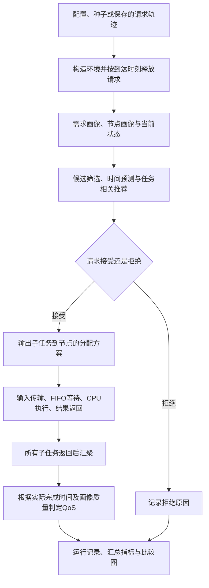

# 当前实验的学习路线与完整流程

整理日期：2026-10-24。对应项目：`/home/sanyue/edge-infer-task`，对应已保存的标准结果：`/home/sanyue/edge-infer-task/results/stage1_standard_v2`。

学习目标：能够选出一条请求，从输入记录开始，解释它为什么被分给这些节点、如何传输和执行、何时完成，以及为什么 QoS 达标或失败。先达到这个目标，再读论文系统模型和算法。

## 1. 先知道自己研究什么

研究场景：没有云端兜底的异构边缘系统接收复杂请求。每个请求包含预先定义的子任务；每个子任务完整交给一个节点执行。节点有不同计算、内存、网络和模型能力，同类任务可以有多个候选节点。研究根据需求和能力选择节点，并协调资源竞争，使更多完整请求满足质量门槛和截止时间。

当前实例：6 个虚拟节点；分类、检测 2 类子任务；每个复杂请求各含一个，两者可并行；所有结果返回后计入汇聚耗时。节点同时只执行一个任务，但可以有多个任务排队，也可以在整个实验中先后处理许多任务。

当前任务类型只是仿真标签。没有真实图片、问题文本、标准答案，也没有加载真实推理模型。模型按黑盒处理，用外部能力参数描述；通用性意味着调度接口不依赖某个模型的内部层结构，尚不等于已经验证所有视觉或语言任务。

当前范围是“已经定义好子任务后，怎样分配”。你仍需说明复杂请求的业务场景、模板、各子任务需求及汇聚规则；自动拆解任意自然语言请求不是本轮研究目标。有先后依赖的视觉问答，需要另外扩展任务依赖，不能仅修改类型名称就认为已经支持。

## 2. 推荐学习顺序与每一步的完成标准

| 顺序 | 先看什么 | 要理解什么 | 自检问题 |
|---|---|---|---|
| 1 | 本文第 1、3 节 | 场景、研究边界、三层输入输出 | 我的算法输出是答案，还是子任务到节点的分配方案？ |
| 2 | 本文第 4 节和配置 | 请求、子任务、节点、模型之间的关系 | 120 个请求为什么生成 240 个子任务？ |
| 3 | 本文第 7 节的实际例子 | 一条请求从输入到验收的全过程 | 完成了为什么仍可能 QoS 失败？ |
| 4 | 需求与能力匹配、时间预测 | 硬约束、裕量评分、传输/排队/计算时间 | 分数为 0 是否一定不可行？画像质量 0.90 是否是实际输出正确？ |
| 5 | 五种分配方法 | 从简单规则到 QoS 贪心，再到联合搜索 | 两个子任务各自选最快，是否保证整个请求最好？ |
| 6 | 执行时间线和统计文件 | 仿真执行与决策预测不同；按完整请求评价 | 预测过门槛为何不能直接计成功？ |
| 7 | HCIO、PRAS | 场景如何写成模型，怎样设计和验证方法 | 文献的输入、决策、目标和约束分别是什么？ |
| 8 | 老师第 1、3 篇及 KDN 背景 | 能力表达、DT 决策价值、架构分工 | 能借鉴哪一部分？哪些假设与我的不同？ |

第一遍按业务和数据流读，不要求先推导所有公式。第二遍再追踪函数和变量。每次带着一条请求核对，比从第一行到最后一行逐字读完整项目更容易建立联系。

## 3. 三个层次的输入、处理与输出

### 3.1 整个实验

输入：环境配置、任务模板、请求数、负载、随机种子，以及要比较的方法；也可以输入已经保存的请求轨迹。

处理：生成或读取轨迹，构造相同初始环境，按到达时间释放请求，重复执行调度和仿真，记录并汇总结果。

输出：每个子任务/请求/节点的运行记录、每次运行的指标、多种子统计表、比较图，以及配置和源码快照。

### 3.2 一次调度算法

输入：本时刻已到达的请求及子任务需求、节点能力画像、当前可观测排队和活跃传输状态。

处理：候选筛选，预测返回时间，计算匹配分数，再按选定规则决定分配。调度器不读取未来尚未到达的请求。

输出：整个请求接受或拒绝；接受时输出“子任务 A → 节点 i，子任务 B → 节点 j”，以及所选模型、画像质量、预测时刻和匹配分数。输出不是图片标签或问答文本，也不是已知的实际完成时间。

### 3.3 仿真执行

输入：分配方案、任务计算量和数据大小、节点和网络资源。

处理：EdgeSimPy 推进时钟和共享网络传输，本项目补充 FIFO、CPU 执行、内存占用、结果返回和请求汇聚。

输出：在仿真中实际发生的输入就绪、开始计算、计算结束、结果返回和请求完成时刻，以及资源占用和最终 QoS。

### 3.4 全流程图



这是对单个请求的流程概括；实际运行中多个请求会交错执行。新请求到达会再次触发调度，传输和执行持续更新状态。

## 4. 输入具体是什么

### 4.1 复杂请求

| 字段 | 含义 |
|---|---|
| `request_id` | 请求编号，用它把轨迹和结果串起来 |
| `arrival_s` | 到达时刻，单位秒 |
| `deadline_s` | 必须完成的绝对截止时刻，单位秒 |
| `aggregation_s` | 全部子任务返回后计入的汇聚耗时 |
| `tasks` | 请求包含的子任务列表 |

截止时刻与允许耗时不同。例如第 10 秒到达，第 13 秒截止，允许耗时为 3 秒。

### 4.2 子任务需求

| 字段 | 含义 |
|---|---|
| `task_type` | 分类、检测等功能类型 |
| `input_class` | 当前是 easy/hard 输入条件标签，不是图片真实类别 |
| `min_quality` | 对该任务要求的最低画像质量水平 |
| `work_gflop` | 基础计算量 |
| `memory_mb` | CPU 执行期间占用的内存 |
| `input_mb`、`output_mb` | 需要传输的输入和输出大小 |

### 4.3 节点画像与动态状态

固定配置包括：算力、可用执行内存容量、接入带宽和传播时延、支持的任务类型、模型标识、按输入条件划分的质量表和计算量系数。

动态状态包括：CPU 当前任务及其完成时刻、已接纳任务队列、正在传输的数据流及剩余数据量。质量画像固定，不等于排队与网络竞争也固定。

节点是资源的提供者，模型是该节点上处理某类任务的能力实例；两者不能混为一物。当前每节点每任务类型只设一个模型，因此主要决策是选节点，尚未额外搜索同节点模型库。

## 5. 推荐、预测与分配怎样衔接

### 5.1 先检查能不能用，再比较合适程度

所有方法都检查任务类型、输入条件和执行内存的基本兼容性。QoS 贪心和联合搜索还检查画像质量和预计时限。

匹配评分采用三个对应维度：

```text
需求 d = [最低质量, 剩余时间预算, 执行内存需求]
能力 c = [画像质量, 预计返回加汇聚耗时, 执行内存容量]
```

对质量、时间和内存分别计算 0～1 的裕量，再按默认权重 0.5、0.4、0.1 加权。分数用于比较候选方案，不是成功概率或模型准确率。恰好满足门槛时裕量可以为 0，仍然可行；不能靠其他维度的高分补偿质量不达标。

当前单执行槽允许等待，所以内存比较使用扣除常驻模型后的执行容量，不是当前瞬时空闲内存。计算量、输入输出大小、算力和网络条件通过时间预测影响分数。

### 5.2 耗时预测需要哪些知识

```text
计算耗时约等于：基础计算量 × 模型计算系数 ÷ 节点算力
传输耗时约等于：数据大小 ÷ 实际分到的带宽，再计传播时延
计算开始时刻：既要等输入就绪，也要等前面的CPU任务完成
请求完成时刻：最晚子任务返回时刻 + 汇聚耗时，再按仿真时间步对齐
```

输入传输和已有任务执行可能重叠，不能机械地把所有等待时间相加。预测使用当前状态和近似带宽；实际网络份额随数据流开始、结束而变化。FIFO 队头输入未就绪时，后面的就绪任务也不能越过它。

### 5.3 五种方法逐步理解

| 阅读顺序 | 方法 | 要抓住的差别 |
|---|---|---|
| 1 | `round_robin` | 基本兼容节点之间轮着分配 |
| 2 | `earliest_finish` | 每个子任务选预计返回最早者，未把质量门槛作为硬约束 |
| 3 | `quality_first` | 优先画像质量，不保证请求能赶上截止时间 |
| 4 | `qos_greedy` | 质量/预计时限过滤后，逐子任务按预计时延和匹配分数选择 |
| 5 | `global_beam` | 比较同请求子任务的分配组合，并对同一 tick 已到达请求做有限宽度联合搜索 |

联合搜索在当前可见批次内先尽量增加接纳请求数，再比较归一化预计请求时延减匹配奖励。它不看到未来，也不是全局最优解。默认稀疏泊松到达下批次通常只有一个请求，所以当前主要检验同请求内联合分配，尚不足以充分验证跨请求协调。

### 5.4 DT 与 KDN 在哪里

当前把“能力画像与针对任务的推荐”作为 DT 侧功能原型，把“综合推荐与当前资源状态进行分配”作为协调控制层原型。预测在 Planner 中实现，评分由推荐函数返回，最终分配仍由 Planner 决定。

具体是同一进程里的函数调用，没有独立 DT 代理通信，也没有完整知识学习模块。还没有实际设备同步、在线质量校正、双新鲜度或运行中重编排。因此应称 DT 辅助推荐与联合分配的基础实现，不能只凭名称声称完整 DT/KDN 系统已经实现。

## 6. 执行后怎样判定成功

一个请求进入队列，不等于开始执行；CPU 执行结束，不等于结果已经返回；某个子任务返回，不等于整个请求完成。

```text
接受请求 → 输入传输 → 等待FIFO和输入就绪 → CPU执行
        → 输出传输 → 全部结果返回 → 汇聚 → 请求完成
```

只有完成、所有所选模型画像质量达到各自门槛、完整请求未超过截止时刻，才记为 `qos_ok=True`。

拒绝、超时、画像质量不达标或排空上限仍未完成，都可能造成 QoS 失败。拒绝和未完成请求仍在 QoS 分母中。超时和质量失败可以重叠，不能把各失败率直接相加。

`predicted_return_s` 是决策时预测的子任务结果返回时刻；`returned_s` 是仿真实际发生的返回时刻，均不含请求最后的汇聚耗时。预测用于决策，实际记录用于最终评价。这里实际仍是仿真结果，不是物理模型测量。

## 7. 用现有结果中的一条请求走完整流程

以下数字直接读取已保存的标准实验文件，仅作四舍五入展示，没有另造实验样本。场景是到达率 1 请求/秒、种子 11，请求编号 `request_000000`。

### 7.1 请求输入

到达时刻 0.602173 秒；截止时刻 3.721718 秒；允许耗时约 3.119545 秒；汇聚耗时 0.02 秒。由于 tick 为 0.01 秒，本次在 0.61 秒的管理回调中接纳。

| 字段 | 分类子任务 | 检测子任务 |
|---|---:|---:|
| 输入条件 | hard | easy |
| 最低画像质量 | 0.85 | 0.85 |
| 基础计算量 GFLOP | 7.031365 | 10.779296 |
| 执行内存 MB | 256 | 768 |
| 输入大小 MB | 2.762154 | 5.171907 |
| 输出大小 MB | 0.02 | 0.10 |

### 7.2 联合搜索输出什么

`global_beam` 接纳该请求，输出：分类 → `edge_04` 的 `synthetic_cls_d`；检测 → `edge_03` 的 `synthetic_det_c`。

| 子任务 | 质量门槛 | 所选画像质量 | 预测返回时刻 | 实际返回时刻 |
|---|---:|---:|---:|---:|
| 分类 | 0.85 | 0.90 | 1.34 秒 | 1.48 秒 |
| 检测 | 0.85 | 0.89 | 1.52 秒 | 1.57 秒 |

分类输入在 0.96 秒就绪并开始执行，1.45 秒计算结束，1.48 秒结果返回。检测输入在 1.27 秒就绪并开始执行，1.54 秒计算结束，1.57 秒结果返回。

完整请求实际在 `max(1.48, 1.57) + 0.02 = 1.59 秒` 完成；时延为 `1.59 − 0.602173 ≈ 0.987827 秒`。质量均过门槛，完成时刻早于 3.721718 秒，最终 `qos_ok=True`。

### 7.3 同一输入为何产生不同结果

| 方法 | 完成时刻 | 画像质量达标 | 按时 | QoS达标 |
|---|---:|---|---|---|
| 轮询 | 1.60 秒 | 否 | 是 | 否 |
| 最早完成 | 1.67 秒 | 否 | 是 | 否 |
| 质量优先 | 2.06 秒 | 是 | 是 | 是 |
| QoS 贪心 | 1.59 秒 | 是 | 是 | 是 |
| 联合搜索 | 1.59 秒 | 是 | 是 | 是 |

最早完成方法为分类选择 `edge_03`，该模型对 hard 输入的画像质量为 0.73，低于 0.85。即使整个请求按时返回，也会因质量不达标而失败。

QoS 贪心选择分类到 `edge_05`、检测到 `edge_03`；联合搜索选择分类到 `edge_04`、检测到 `edge_03`。二者本例完成时间相同，但分类画像质量不同。这是一条请求的解释，不是联合搜索整体更优的证据。

### 7.4 用哪些文件对照

先在 `/home/sanyue/edge-infer-task/results/stage1_standard_v2/traces/rate_1_seed_11.json` 搜索 `request_000000`，看输入。

再在 `/home/sanyue/edge-infer-task/results/stage1_standard_v2/runs/rate_1_seed_11/global_beam/tasks.csv` 按相同 `request_id` 找两行，查看选择的节点和时间线。

最后在 `/home/sanyue/edge-infer-task/results/stage1_standard_v2/runs/rate_1_seed_11/global_beam/requests.csv` 找同一请求，核对 `finish_s`、`latency_s`、`quality_ok`、`on_time`、`qos_ok`。

换到 `/home/sanyue/edge-infer-task/results/stage1_standard_v2/runs/rate_1_seed_11/earliest_finish` 中的同名 CSV，就能对照同一输入为何产生不同结果。

## 8. 读代码的顺序与重点函数

项目根目录始终为 `/home/sanyue/edge-infer-task`。下表所有路径均从该项目展开。

| 顺序 | 文件绝对路径 | 第一遍只抓什么 |
|---|---|---|
| 1 | `/home/sanyue/edge-infer-task/config/default.json` | 节点、任务、网络和实验规模从哪里来 |
| 2 | `/home/sanyue/edge-infer-task/stage1/scenario.py` | `Request`、`TaskDemand`、`NodeSpec`、`Capability`，以及 `generate_requests` |
| 3 | `/home/sanyue/edge-infer-task/stage1/matching.py` | `recommend` 的输入、三个裕量和输出 `DTRecommendation` |
| 4 | `/home/sanyue/edge-infer-task/stage1/planner.py` | 先看 `compatible`、`estimate`、`_score`；再看 `plan_batch` 中简单规则及贪心；最后看 `_joint_options` 和 beam 分支 |
| 5 | `/home/sanyue/edge-infer-task/stage1/engine.py` | 先跟踪 `TaskState` 与 `_manage`；再看网络创建、完成收集及当前队尾估计 |
| 6 | `/home/sanyue/edge-infer-task/run.py` | `main` 如何组织重复实验；`summarize` 如何计算指标；`aggregate` 如何跨种子汇总 |
| 7 | `/home/sanyue/edge-infer-task/validate_results.py` | 理解它独立复查哪些输出，不用第一遍逐行研究 |

先读主流程，再回头读参数检查、哈希、绘图和框架适配细节。第一次无需先阅读整个 EdgeSimPy 源码。

可在 VS Code 的 WSL Ubuntu 终端运行一个教学小例子：

```bash
conda activate edge_dt
cd /home/sanyue/edge-infer-task
python run.py --suite smoke --request-count 3 --seeds 11 --arrival-rates 1 --methods qos_greedy,global_beam
```

这会生成一份新结果，只运行 1 组请求、2 种方法，共 2 次仿真，便于理解。请求总数变少可能影响后续竞争，不要求教学小例子的时间线与 120 请求标准实验完全相同。该运行规模不用于论文结论。

## 9. 看结果的顺序

先看单请求与子任务，再看统计，不要先盯着哪条曲线最高。

| 输出 | 用它回答什么 |
|---|---|
| 轨迹 JSON | 原来要求系统处理什么？ |
| `tasks.csv` | 分给谁？预测是什么？输入、计算和返回分别在什么时候发生？ |
| `requests.csv` | 完整请求最终是否完成、按时、画像质量达标？ |
| `nodes.csv` | 哪些节点忙，执行内存占用了多少？ |
| `metrics.csv` | 某个负载、种子和方法的单次运行表现怎样？ |
| `summary.csv` | 同负载同方法在多种子下平均表现和波动怎样？ |
| 比较图 | 负载增大时，方法差异和波动如何变化？ |
| `manifest.json`、源码和配置快照 | 这次结果究竟用什么环境、代码和参数产生？ |

标准实验有 3 个负载、5 个种子，即 15 组轨迹，每组分别交给 5 种方法，所以是 75 次仿真。相同轨迹的方法之间是配对比较，并不是 75 组互不相关的数据。

QoS 达标率分母包括全部请求。平均和 P95 时延只统计已完成请求，包括超时或质量失败的已完成样本。低时延可能伴随高拒绝率，所以应同时看 QoS、拒绝率、未完成率与时延。

P95 是延迟分布约第 95 百分位，用于观察较慢的一部分请求；不是最大值。当前图中的误差棒是种子间样本标准差，不是置信区间。当前汇总 P95 是各次运行 P95 的均值，不是合并所有请求后重算的 P95。

## 10. 需要掌握的知识框架

| 知识组 | 现在需要掌握到什么程度 |
|---|---|
| 任务与系统 | 分清请求/子任务、节点/模型、部署/调度、并行/依赖、接纳/执行/返回 |
| 计算与网络 | 会用计算量除算力、数据量除带宽估算时间；理解排队、共享带宽、传播时延和 FIFO |
| 数学与算法 | 理解向量、归一化、加权评分、硬约束、优化目标、贪心与有限宽度搜索 |
| Python | 能读函数参数和返回值、类/数据类、列表和字典、循环、JSON/CSV；沿调用关系找数据 |
| 仿真与统计 | 理解时钟、tick、当前可见状态、种子、轨迹复用、均值/标准差/P95 |
| 论文实验 | 分清基线、消融、敏感性、参数来源、适用范围，以及机制可运行和创新有效两种证据 |

后续再补：AoI、真实状态与 DT 观测状态的差别、质量画像随输入变化或模型变化的更新、运行偏差触发的重调度。大模型训练、Transformer 层结构、强化学习和复杂自动任务规划不是理解本轮代码的前置条件。

## 11. 论文阅读顺序与带着什么问题读

先理解上面的场景和实际例子，再开始第一篇。不用等 Python 和所有数学都学完才读论文。

### 11.1 第一篇：老师第 2 篇 HCIO

完整题名：[Age-of-Information-Aware Hierarchical Collaborative Inference in Digital Twin-Enabled Vehicular Edge Computing](https://doi.org/10.1109/TNSE.2025.3615533)。中文可理解为“数字孪生赋能车载边缘计算中考虑信息年龄的分层协同推理”。

先学它如何组织场景、任务、节点、DT 和层次决策，如何把这些对象写成决策变量、目标与约束，再读算法与实验。用它建立论文建模的骨架，不要求第一遍推完公式。

对照当前实验：任务放到谁、DT 相关决策、资源分配分别位于哪一层？哪些是输入已知量，哪些是优化变量？其状态 AoI 与模型质量变化不是同一概念；当前代码没有复现其完整算法。

### 11.2 第二篇：此前推荐的 PRAS

完整题名：[Adaptive scheduling of online inference pipelines at the edge: A post-hoc request-oriented approach](https://doi.org/10.1016/j.sysarc.2025.103597)。中文可理解为“边缘在线推理流水线的自适应调度：面向请求的事后调整方法”。

重点关注：多阶段推理请求为何需要同时考虑质量和时延；怎样根据已积累请求进行在线配置；模型配置和批大小如何决策；怎样使用反馈在线刻画流水线质量；突发负载下怎样验证方法。

该文采用阶段配置的图表示与多臂老虎机在线质量刻画。第一次知道这些模块分别解决什么问题即可，第二遍再看图搜索和 MAB 细节。它是多阶段流水线，当前是两个并行子任务；它的模型配置/批处理也不是当前节点选择的原样对应物。

### 11.3 第三篇：老师第 1 篇

题名：Capability-Aware Distributed Learning and Inference for Heterogeneous 6G Edge Environments。

重点看异构能力如何表达、什么能力差异会改变任务分配，可借鉴哪些字段或匹配依据。它涉及同一 DNN 的分块、分层协作，当前是不同子任务完整放到节点，必须区分分配粒度。

### 11.4 第四篇：老师第 3 篇

题名：Adaptive Device-Edge Collaboration on DNN Inference in AIoT: A Digital-Twin-Assisted Approach。

重点看 DT 为决策提供了什么额外价值，怎样评估候选操作、适应条件变化。它的设备—边缘 DNN 切分/退出和最优停止问题，与当前多节点整子任务分配不同，适合借鉴思路而非直接替换算法。

### 11.5 架构背景：KDN 论文

题名：Knowledge-Defined and Twin-Assisted Network Management for 6G。

先看框架图，理解状态、DT、知识/决策和控制执行之间的关系。后续画自己的总体框架时再回看细节。当前评分函数不等于已实现该文的知识学习或完整 KDN。

上述老师本地论文位于 `D:/onedrive/Desktop/文献`。当前五种方法是原型对比方案，不是以上论文的完整算法复现。

### 11.6 每篇论文都按同一顺序读、记同一张表

第一遍顺序：摘要和引言 → 系统图/场景 → 问题定义 → 实验设置与结果 → 算法流程。第二遍再回到变量表、公式和证明。

| 笔记项 | 必须写清的问题 |
|---|---|
| 背景与问题 | 什么实际条件让已有办法不好用？ |
| 输入 | 请求提供什么？节点观测什么？哪些参数假设已知？ |
| 决策与输出 | 选节点、选模型、分资源、选切分点，还是决定何时更新？ |
| 目标与约束 | 到底优化什么？哪些条件绝对不能违反？ |
| 方法 | 每个模块分别解决哪个困难，怎样衔接？ |
| 实验 | 数据、资源参数从哪里来？与谁比？做了哪些消融和敏感性？ |
| 可借鉴与差别 | 能改进我目前哪一步？哪些假设不能直接沿用？ |

## 12. 看懂之后，下一步怎样推进

进入改进算法前，先能独立完成：

1. 说清当前场景、输入和决策输出。
2. 用上述实际请求，解释每个子任务为什么合适或不合适。
3. 对照轨迹、任务 CSV 和请求 CSV，手算完整请求的完成时刻与 QoS。
4. 说明贪心与联合搜索的差别，说明预测误差从哪里来。
5. 给 HCIO 和 PRAS 各写一张上述笔记表。

随后再确定一个可检验问题，例如：具有互补能力的节点上，联合选择在什么条件下能避免逐任务贪心失误？突发到达时能否改善跨请求协调？应先明确假设，再设计负载/能力差异和消融，而不是为了领先去调参数。

目前标准结果中联合搜索没有稳定超过 QoS 贪心。这说明现有代码已打通实验与核验流程，但创新收益尚未稳定证实。下一步应结合文献选择合适基线、补充参数依据和有区分力的场景。纯仿真仍可继续，真实模型测量不是老师要求下必须立即加入的前置条件。
